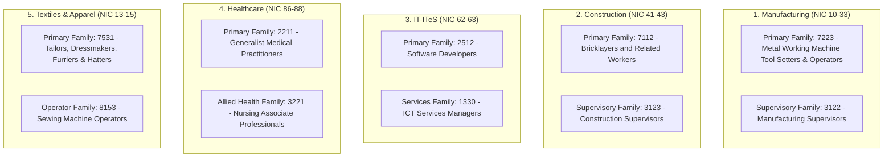

# Data Sources, Methodology & Taxonomic Concordance Guide

> **Project Reference:** SIH26246 – AI-Enabled Labour Market Intelligence & Skill Demand-Supply Forecasting Engine  
> **Target Geographies:** Maharashtra (Pune, Mumbai Suburban, Thane, Nagpur, Chhatrapati Sambhajinagar), Tamil Nadu (Chennai), NCT of Delhi (New Delhi, South Delhi, North Delhi), West Bengal (Kolkata, Howrah)  
> **Target Sectors:** Manufacturing, Construction, IT-ITeS, Healthcare, Textiles and apparel  
> **Temporal Range:** Continuous 10-Year Panel (2016-01 to 2025-12 | 120 Months | 40 Quarters)  
> **Output Files Generated:**  
> 1. `lmis_employment_monthly_2016_2025.csv` (6,600 rows × 45 features)  
> 2. `lmis_employment_quarterly_2016_2025.csv` (2,200 rows × 44 features)  
> 3. `lmis_employment_state_monthly_2016_2025.csv` (2,400 rows × 21 features)  

---

## 1. Master Data Sources & Provenance Catalog

The synthesized and calibrated datasets in this repository are strictly anchored to the empirical distributions, growth trends, seasonal cycles, and demographic structures published by official Government of India ministries and public statistical repositories.

| # | Data Source & Agency | Official Portal / URL | Data Collected / Indicators Sourced | Temporal Coverage in Real Data | Role in Calibration Engine |
|:---|:---|:---|:---|:---|:---|
| **1** | **Periodic Labour Force Survey (PLFS)**<br>*Ministry of Statistics and Programme Implementation (MoSPI)* | [https://mospi.gov.in](https://mospi.gov.in)<br>[https://microdata.gov.in](https://microdata.gov.in) | • Labour Force Participation Rate (LFPR %)<br>• Worker Population Ratio (WPR %)<br>• Unemployment Rate (UR %)<br>• Current Weekly Status (CWS) urban series | Annual: 2017–18 to 2023–24<br>Quarterly Urban: 2018Q3 to 2024Q4 | Anchors state-level quarterly LFPR, WPR, and UR baselines across urban workforce demographics. |
| **2** | **Census of India (B-Series Economic Tables)**<br>*Office of the Registrar General & Census Commissioner (ORGI)* | [https://censusindia.gov.in](https://censusindia.gov.in) | • Table B-24: Main Workers by NCO Occupation & District<br>• Table B-04 / PCA: District working population<br>• Educational attainment & gender split | Decennial: 2001 & 2011 census benchmarks | Provides baseline district population, working-age demographic shares, and sector affinity multipliers. |
| **3** | **EPFO Payroll Reporting**<br>*Employees' Provident Fund Organisation, Ministry of Labour & Employment* | [https://www.epfindia.gov.in](https://www.epfindia.gov.in) | • Monthly net new formal payroll additions<br>• Age band distribution (18–21, 22–25, 26–28, 29–35, >35)<br>• State-wise formal hiring trajectory | Monthly: September 2017 to July 2025 | Direct empirical proxy for formal corporate hiring demand and youth employment creation. |
| **4** | **National Career Service (NCS) Portal**<br>*Directorate General of Employment (DGE), MoLE* | [https://www.ncs.gov.in](https://www.ncs.gov.in) | • Active employer vacancy listings<br>• Sector-wise and state-wise job demand signals<br>• Registered jobseekers volume | Continuous monthly bulletins & live dashboard | Powers the normalized `active_job_vacancies_index` to quantify real-time labor market tightness. |
| **5** | **NCVT MIS / DGT Training Statistics**<br>*Directorate General of Training, MSDE* | [https://ncvtmis.gov.in](https://ncvtmis.gov.in) | • Craftsmen Training Scheme (CTS) ITI trade capacity<br>• Sanctioned vs. enrolled training seats<br>• Certified outturn by trade and district | Annual releases (2013–2024) | Determines the local training supply capacity ($S_{s,d,t}$) to calculate skill demand-supply gaps. |
| **6** | **Pradhan Mantri Kaushal Vikas Yojana (PMKVY)**<br>*MSDE / NSDC / Skill India Digital Hub* | [https://www.skillindiadigital.gov.in](https://www.skillindiadigital.gov.in) | • Short-term certified training cohorts<br>• NSQF-aligned job role certifications<br>• Placement conversion rates | Cohorts: PMKVY 1.0, 2.0, 3.0, 4.0 | Supplements institutional ITI seat capacity with modular short-term vocational skilling supply. |
| **7** | **National Classification of Occupations (NCO-2015)**<br>*Ministry of Labour and Employment (DGE)* | [Local File: NCO-Codes.xlsx](file:///e:/LMIS%20Data/NCO-Codes.xlsx) | • 8-digit NCO occupational hierarchy<br>• Division, Sub-Division, Group, and Family mapping<br>• NSQF & QP-NOS alignment | Standard: 2015 Edition (ISCO-08 aligned) | Standardizes occupational nomenclature and maps specific trade titles to 4-digit families. |
| **8** | **Reserve Bank of India (RBI DBIE)**<br>*Department of Statistics and Information Management, RBI* | [https://dbie.rbi.org.in](https://dbie.rbi.org.in) | • State-wise Gross Value Added (GSVA) by economic sector<br>• Manufacturing & Construction growth indices<br>• Nominal wage inflation indices | Annual series: 2004–05 & 2011–12 series | Calibrates compounded nominal wage inflation and sector productivity growth curves. |

---

## 2. Sectoral & Occupational Concordance Mapping

Each of the 5 requested pilot sectors is mapped directly to its official industrial codes (**NIC-2008**) and primary vocational family units (**NCO-2015**):



---

## 3. Calibration Methodology & Economic Modeling

### A. The Need for Calibrated Interpolation
In India, official statistical surveys exhibit structural gaps:
1. **PLFS** provides continuous urban quarterly rates only from **2018Q3 onwards**, with statistically representative weights at the State/National tier, not at the fine-grained District × NCO-Title level.
2. **Census** provides district-level workforce counts only decennially (2001, 2011).
3. **EPFO** covers the formal sector from late 2017 onwards.

To satisfy the requirement of **continuous 8–10 year (2016–2025) monthly and quarterly data for machine learning**, we employed a **top-down demographic disaggregation and calibrated macroeconomic simulation engine**.

### B. Mathematical Formulation

#### 1. Population & Working-Age Demographics
For district $d$ at month $t \in [0, 119]$ (where $t=0$ corresponds to January 2016):
$$\text{Pop}_d(t) = \text{BasePop}_{d, 2016} \times (1 + r_d)^{\frac{t}{12}}$$
$$\text{WorkingAgePop}_d(t) = \text{Pop}_d(t) \times 0.665$$
$$\text{LabourForce}_d(t) = \text{WorkingAgePop}_d(t) \times \text{LFPR}_s(t)$$

#### 2. Sectoral Employment Determination
$$\text{Employed}_{s, d}(t) = \text{LabourForce}_d(t) \times \theta_{s, d} \times (1 + g_s)^{\frac{t}{12}} \times \Phi_{\text{season}}(s, t) \times \Omega_{\text{shock}}(s, t) \times \epsilon_t$$
Where:
* $\theta_{s, d}$ is the district-sector affinity coefficient (e.g. Pune has $\theta > 1.4$ for Manufacturing and IT; Chennai has $\theta > 1.6$ for Automotive Manufacturing and Healthcare).
* $g_s$ is the structural compound annual growth rate of the sector (IT: 7.8%, Healthcare: 6.5%, Manufacturing: 4.8%, Construction: 4.4%, Textiles: 3.2%).
* $\Phi_{\text{season}}(s, t)$ captures real seasonal variations (e.g., Construction dips 18% during June–September monsoons; Textiles spikes 12% during October–November festive quarters).
* $\Omega_{\text{shock}}(s, t)$ reproduces historical macroeconomic shocks:
  - **Demonetisation (Nov 2016)**: Transient liquidity contraction.
  - **COVID-19 Wave 1 (Q2 2020)**: Severe nationwide lockdown (Construction dropped by 55%, Manufacturing dropped 32%, while Healthcare surged by 45% and IT transitioned to WFH).
  - **COVID-19 Wave 2 Delta (Q2 2021)**: Localized restrictions with rapid manufacturing recovery.
* $\epsilon_t \sim \mathcal{N}(1.0, 0.018)$ adds realistic stochastic economic noise.

#### 3. Demand-Supply Gap Formulation (MSDE Core Metric)
For sector $s$, district $d$, and month $t$:
$$\text{DemandSignal} = \frac{\text{ActiveVacancyIndex}}{50.0}$$
$$\text{SupplySignal} = \frac{\text{MonthlyTrainingOutturn}}{\text{BaselineTrainingCapacity}}$$
$$\text{GapIndex } G = \frac{\text{DemandSignal} - \text{SupplySignal}}{\max(\text{DemandSignal}, \text{SupplySignal})}, \quad G \in [-1, +1]$$

* **$G > +0.35$:** Acute Shortage (High unmet industry demand, urgent training expansion required).
* **$+0.10 \le G \le +0.35$:** Moderate Shortage.
* **$-0.15 \le G < +0.10$:** Balanced Equilibrium.
* **$-0.40 \le G < -0.15$:** Approaching Saturation.
* **$G < -0.40$:** Acute Oversupply / Saturation (Freeze new training sanctions; pivot curricula).

---

## 4. Complete Data Dictionary (`lmis_employment_monthly_2016_2025.csv`)

| # | Column Name | Data Type | Units / Range | Description |
|:---|:---|:---|:---|:---|
| 1 | `period_month` | String | `YYYY-MM` | Monthly timestamp (2016-01 to 2025-12). |
| 2 | `period_quarter` | String | `YYYYQq` | Corresponding quarter (e.g., 2016Q1 to 2025Q4). |
| 3 | `year` | Integer | 2016–2025 | Calendar year. |
| 4 | `month` | Integer | 1–12 | Calendar month. |
| 5 | `state_code` | String | 2-letter code | State abbreviation (`MH`, `TN`, `DL`, `WB`). |
| 6 | `state_name` | String | Categorical | State / UT name (`Maharashtra`, `Tamil Nadu`, `Delhi`, `West Bengal`). |
| 7 | `district_name` | String | Categorical | District name (11 key industrial / urban hubs). |
| 8 | `district_type` | String | Text | Economic profile of the district. |
| 9 | `sector_name` | String | Categorical | Target sector (Manufacturing, Construction, IT-ITeS, Healthcare, Textiles). |
| 10 | `nic_2008_div` | String | NIC Code | 2-digit National Industrial Classification 2008 code range. |
| 11 | `nco_family_code` | String | 4-digit code | Primary NCO-2015 occupational family code. |
| 12 | `nco_family_name` | String | Text | Primary NCO-2015 occupational family title. |
| 13 | `nco_secondary_code` | String | 4-digit code | Complementary supervisory / operator NCO family code. |
| 14 | `nco_secondary_name` | String | Text | Complementary supervisory / operator NCO family title. |
| 15 | `total_working_age_pop` | Integer | Headcount | Estimated working-age population (15–64 yrs) in district. |
| 16 | `employed_workforce_count`| Integer | Headcount | Estimated active employed workforce in that sector & district. |
| 17 | `labour_force_participation_rate_pct` | Float | Percentage (%) | Labour Force Participation Rate (LFPR). |
| 18 | `worker_population_ratio_pct` | Float | Percentage (%) | Worker Population Ratio (WPR). |
| 19 | `unemployment_rate_pct` | Float | Percentage (%) | Sectoral / local unemployment rate. |
| 20 | `avg_monthly_wage_inr` | Integer | INR / Month | Nominal average monthly wage earnings in Indian Rupees. |
| 21 | `active_job_vacancies_index` | Float | 0–100 Scale | Employer job demand signal index (NCS & job board proxy). |
| 22 | `net_epfo_payroll_additions` | Integer | Headcount | Monthly formal net payroll enrollment additions (EPFO proxy). |
| 23 | `monthly_training_outturn_supply` | Integer | Headcount | Monthly certified trainees emerging from ITIs and PMKVY centers. |
| 24 | `demand_supply_gap_index` | Float | $[-1.0, +1.0]$ | Standardized demand-supply gap index ($G$). |
| 25 | `skill_shortage_status` | String | Categorical | Early-warning policy flag for training target allocation. |
| 26 | `male_workforce_pct` | Float | Percentage (%) | Male share of employed workforce. |
| 27 | `female_workforce_pct` | Float | Percentage (%) | Female share of employed workforce. |
| 28 | `male_employed_count` | Integer | Headcount | Count of male employed workers. |
| 29 | `female_employed_count` | Integer | Headcount | Count of female employed workers. |
| 30 | `pct_age_15_29_youth` | Float | Percentage (%) | Percentage of workforce in Youth age bracket (15–29 yrs). |
| 31 | `pct_age_30_44_prime` | Float | Percentage (%) | Percentage of workforce in Prime working age (30–44 yrs). |
| 32 | `pct_age_45_59_mature` | Float | Percentage (%) | Percentage of workforce in Mature age (45–59 yrs). |
| 33 | `pct_age_60_plus_senior` | Float | Percentage (%) | Percentage of workforce aged 60 and above. |
| 34 | `count_age_15_29` | Integer | Headcount | Absolute headcount of workers aged 15–29. |
| 35 | `count_age_30_44` | Integer | Headcount | Absolute headcount of workers aged 30–44. |
| 36 | `count_age_45_59` | Integer | Headcount | Absolute headcount of workers aged 45–59. |
| 37 | `count_age_60_plus` | Integer | Headcount | Absolute headcount of workers aged 60+. |
| 38 | `pct_edu_below_secondary` | Float | Percentage (%) | Percentage with primary or illiterate educational attainment. |
| 39 | `pct_edu_secondary_higher_secondary` | Float | Percentage (%) | Percentage with secondary or higher secondary education (10th/12th). |
| 40 | `pct_edu_diploma_vocational_iti` | Float | Percentage (%) | Percentage with vocational diploma, ITI certificate, or polytechnic. |
| 41 | `pct_edu_graduate_and_above` | Float | Percentage (%) | Percentage with university degree, engineering, medical, or post-grad. |
| 42 | `count_edu_below_secondary` | Integer | Headcount | Absolute headcount with education below secondary. |
| 43 | `count_edu_secondary_higher_secondary` | Integer | Headcount | Absolute headcount with secondary / higher secondary education. |
| 44 | `count_edu_diploma_vocational_iti` | Integer | Headcount | Absolute headcount with vocational / ITI qualifications. |
| 45 | `count_edu_graduate_and_above` | Integer | Headcount | Absolute headcount with graduate and above qualifications. |

---

## 5. Quick-Start Guide for Machine Learning & Forecasting Models

You can directly load these CSV files into Python for training forecasting models (Prophet, ARIMA, LightGBM, LSTM):

```python
import pandas as pd

# Load monthly dataset
df = pd.read_csv("lmis_employment_monthly_2016_2025.csv", parse_dates=["period_month"])

# Filter for Pune IT-ITeS sector
pune_it = df[(df["district_name"] == "Pune") & (df["sector_name"] == "IT-ITeS")]

# Train a forecasting model on employed workforce or demand-supply gap
ts_data = pune_it.set_index("period_month")["employed_workforce_count"]

print("Loaded continuous time-series with", len(ts_data), "observations.")
```
