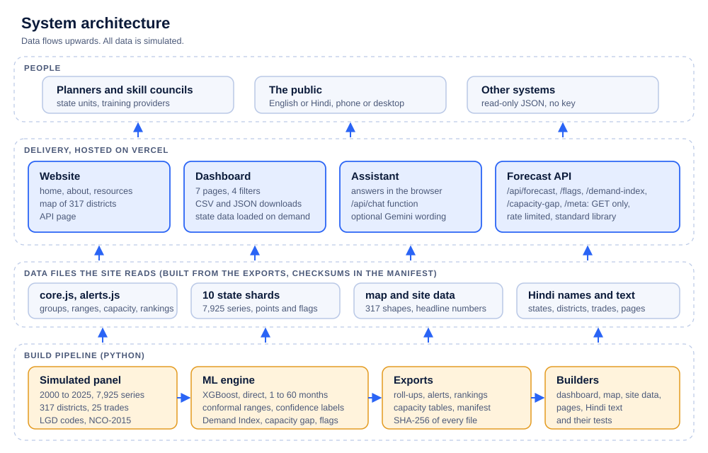
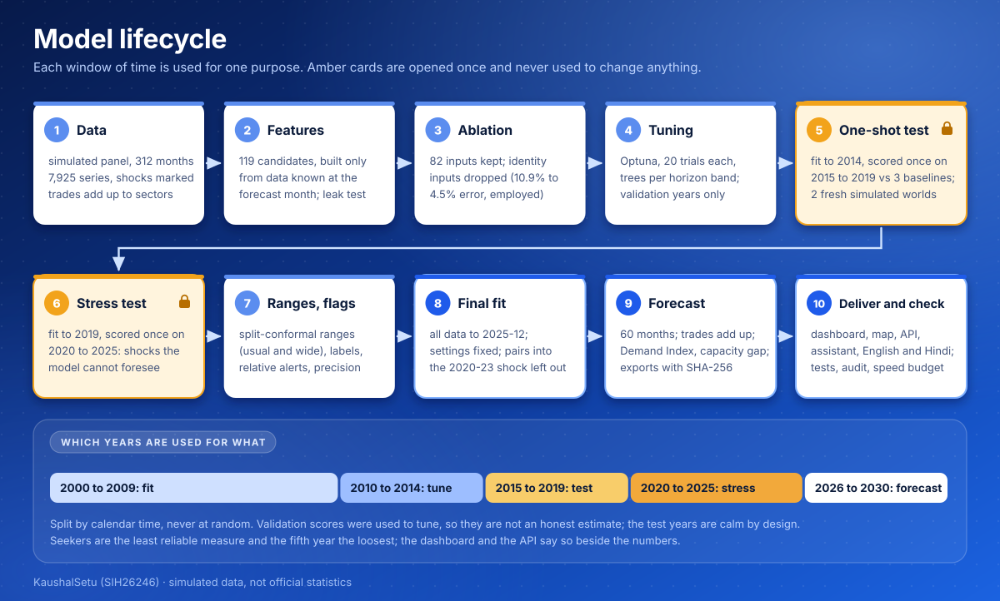

# KaushalSetu

**Bridging Skills. Forecasting Futures.**

KaushalSetu is an AI-enabled labour market intelligence and skill demand-supply forecasting platform for the Ministry of Skill Development and Entrepreneurship. It forecasts, **five years ahead (January 2026 to December 2030)**, how many people will be employed, how many jobs will be open and how many job seekers will be registered, for **all 317 districts of ten states, five sectors and 25 trades (7,925 series)**. Every forecast carries two 90% ranges and a confidence label; a **Demand Index**, a **capacity gap** against training seats and **early-warning flags** are built on top. The website, the dashboard (English and Hindi), an assistant and a read-only JSON API serve the same numbers.

> **All data in this project is simulated.** It behaves like official statistics (it is calibrated to published figures where they could be checked) but describes no real district. Results show how the method works, not what is happening in any real labour market.

## Problem Statement

- **Problem Statement ID**: SIH26246
- **Problem Statement Title**: AI-Enabled Labour Market Intelligence and Skill Demand-Supply Forecasting Engine
- **Ministry / Department**: Ministry of Skill Development and Entrepreneurship (MSDE)
- **Category**: Software
- **Theme**: Miscellaneous
- **Team name**: Versec0ders
- **Team ID**: 168356
- **Members**:

| Member Name | Role | Key Contributions | Contact |
|---|---|---|---|
| Divya | Team Leader | <contribution> | divyasin58@gmail.com  |
| Sara Sinha | Member | <contribution> | sara.sinha.100@gmail.com |
| Rishabh Kumar Singh | Member | <contribution> | rishabhkumarsingh1112@gmail.com  |
| Vyomsoni | Member | <contribution> | svyom21@gmail.com |
| Ayush Kumar Gupta | Member | <contribution> | ayushkumargupta018@gmail.com |
| Shubham Raj | Member | <contribution> | Shubham748856@gmail.com |

The first submission (v3: 56 districts, twelve-month forecasts) is preserved at the git tag `submitted-v1`; this branch is the extended version (v4). The plan and the results of every phase are in `docs/v4-implementation-plan.md`. The method, step by step, with the Demand Index formula, a worked example, the evaluation and the limits, is in `docs/METHODOLOGY.md`.



## 1. Why we built this and who benefits
**Why.** Training seats are sanctioned months or years ahead, but labour demand shifts month by month and varies sharply between districts and trades. Planners need to see *where* demand and supply are moving apart *early enough to act*, and how far to trust each number. Most tools give a point estimate; KaushalSetu gives the range (usual and wide), the confidence, the baseline it must beat, and the limits.

**Who benefits.** MSDE and NCVET planners (where to sanction seats); Sector Skill Councils (which trades are heading for saturation or shortage); state skill-development units (state to district, in Hindi or English); training providers (course and seat alignment); researchers and evaluators (a transparent, reproducible method with the evaluation tables and checksums); other systems (a documented read-only API).

## 2. Key features
**Forecasting and statistics**
* **60-month forecasts** of employed workers, job vacancies and registered job seekers for 7,925 district-trade series; trades are reconciled so that point forecasts add up to the sector, state and India.
* **Two 90% ranges** (split-conformal): the *usual* range calibrated on 2010-2019 and the *wide* range that also uses the shock years 2020-2025; confidence labels (high, medium, low) from the error of earlier forecasts for the same trade and horizon band.
* **Demand Index** (0 to 100) from vacancies, job-portal postings and National Career Service openings per worker, compared with the other districts of the same trade, with a national level term so that it moves over the years.
* **Capacity gap**: forecast openings against sanctioned training seats (held flat, an assumption) and expected certified trainees, by year, trade, state and district, with a relative mismatch status.
* **Severity ranking**: trades, states, state-trade pairs, districts, district-sectors and district-trades ranked by how far trained supply is from the openings (score = ln of certified per opening; severe, high, moderate, balanced; undersupply or oversupply), for any year to 2030, filterable, on the Rankings page and at `/api/severity`.
* **Seat scenarios**: change the seats by a percentage from a chosen year (for a trade, a state's trades or a district's trades) and see the ratio and severity before and after and the seats needed to reach a target, on the Capacity gap page and at `/api/scenario`.
* **Early-warning alerts**: in each trade and month the top and bottom tenth of districts by forecast vacancies per seeker, with watches either side; their precision against persistence is reported. The Early warnings page and `/api/flags?change=entering|leaving` also show which series **enter or leave** an alert tail between now and 12, 36 or 60 months ahead, and the first month a series is in the tail.

**Public website** (Home, About, Resources, API page): a map of all 317 districts with the state borders drawn (sector, measure, 12/36/60 months, a keyboard "find a district" list), a hero forecast chart, the method, the evaluation stated honestly (including the shock years), English and Hindi, light and dark themes, three text sizes, reduced-motion support.

**Dashboard** (`app/dashboard/`): Overview, Map (all 317 districts with state borders, the states, the highest and lowest districts and where the alerts are), Forecast, Demand Index, Capacity gap, Rankings, Early warnings, and Data and notes; filters for sector, trade, state and district kept in the URL; two-band charts; CSV and JSON download of any table; data loaded per state on demand; English and Hindi (names included).

**Forecast API** (`/api/forecast`, `/flags`, `/demand-index`, `/capacity-gap`, `/severity`, `/scenario`, `/meta`): GET only, filters as on the dashboard, no key; refuses bad input, rate limited, standard library only. Documented at `docs/api.html` on the site.

**Assistant**: answers in the browser from the site's own data (totals, a district, ranges, Demand Index, capacity, alerts, rankings, definitions); optionally words answers with Google Gemini through a server route that keeps the key off the page.

**Engineering**: every number on the site is built from the exports and checked against them; SHA-256 manifests; leak-safe splits by calendar time with the test and stress windows opened once; 268 automated tests; security headers; an accessibility audit script and fixes.

## 3. Technology stack
| Layer | Technology |
|---|---|
| Language | Python 3.12+ (tested on 3.13); JavaScript (no framework) |
| Data and numerics | pandas 2.2, NumPy 2.1, SciPy 1.14, PyArrow 20 (Parquet), joblib |
| Machine learning | **XGBoost 3.4** (final models, direct multi-horizon), **Optuna 4.1** (tuning), LightGBM and scikit-learn (earlier model comparison) |
| Uncertainty | Split-conformal ranges on the log change, by horizon, with leave-one-window-out checks (own implementation) |
| Front end | Hand-written HTML, CSS and JavaScript; SVG charts and map; Geist and Noto Sans Devanagari; no build tool or framework |
| Internationalisation | English and Hindi via generated `data-hi` attributes (BeautifulSoup 4 at build time) and a names dictionary |
| Backend | Python standard library `http.server` (local server); eight Vercel Python functions (`/api/chat` and the seven forecast API routes) |
| AI assistant | Rule-based engine in the browser; Google Gemini REST API (optional, server-side key) |
| Testing | Plain-Python test files (no framework needed; pytest also works); Node.js only to syntax-check and run the assistant engine |
| Data formats | CSV, Parquet, JSON, GeoJSON, SVG |

## 4. Overview of the dataset
The modelling dataset is a **simulated** monthly panel (`src/v4/generate.py`, seed 42), keyed by official LGD district codes and NCO-2015 occupation codes.

| Item | Detail |
|---|---|
| Panel | `data/v4/raw/trade_monthly_2000_2025.parquet`: 24,72,600 rows x 17 columns (git-ignored, rebuilt by the generator; hashes in `data/v4/DATA_MANIFEST.json`) |
| Series | 7,925 = 317 districts x 25 trades; 312 months (January 2000 to December 2025) |
| Geography | Delhi 11, Gujarat 33, Karnataka 31, Kerala 14, Maharashtra 36, Punjab 23, Tamil Nadu 38, Telangana 33, Uttar Pradesh 75, West Bengal 23 districts; 785-district LGD boundary layer for the map |
| Sectors and trades | Manufacturing, Construction, IT-ITeS, Healthcare, Textiles and Apparel, five NCO-2015 trades each |
| Forecast targets | `Total_Employed_Workers`, `Active_Job_Vacancies`, `eShram_Registered_Seekers` |
| Other columns | Training seats and certified trainees, wage, unemployment rate, population, worker shares, four demand channels (portal postings, hiring survey, NCS vacancies, labour-force survey) |
| Known structure | COVID shock (2020-2023), the e-Shram registration ramp from August 2021, seasonality, sector and district differences |
| Windows | Fit to 2009, tune 2010-2014, test 2015-2019 (opened once), stress 2020-2025 (opened once), final fit to 2025-12, forecast 2026-2030 |

The data dictionary is `data/v4/DATA_DICTIONARY.csv`; the sources and what the simulator was calibrated to are on the Resources page.

## 5. ML model and its evaluation metrics


**Model.** One XGBoost model per target; the number of months ahead (1 to 60) is an input and the target is the change in the log level; three seeds averaged; 82 inputs chosen from 119 candidates (dropping inputs that identify one district or sector cut the validation error of employed workers from 10.9% to 4.5%); trees per twelve-month horizon band chosen on the validation years. The final fit uses all data to December 2025 and leaves out the training pairs that reach into the 2020-2023 shock and recovery (a first fit on all pairs repeated that jump as if it were a normal month: seekers x3.8 by 2030).

**Evaluation.** Metric: WAPE (lower is better), against the best of three simple forecasts (no change, seasonal naive, damped trend).

### Test years 2015-2019 (opened once), all horizons
| Target | Model WAPE | Best simple forecast | Closer | Bias |
|---|---|---|---|---|
| Employed workers | **4.64%** | 5.65% | **17.8%** | +2.3% |
| Registered job seekers | **16.15%** | 17.63% | **8.4%** | -14.8% |
| Job vacancies | **13.14%** | 13.61% | **3.5%** | +5.8% |

Employed workers beat the baseline at every horizon (4% at 1-12 months, 30% at 49-60). Seekers are 3.7% worse in the first year and 23% better in the fifth; vacancies are better to 48 months and 3% worse at 49-60. On two fresh simulated worlds (no refit): employed 4.61% and 4.60% against 5.61% and 5.55%.

### Shock years 2020-2025 (opened once, information only)
Employed workers 14.29% against 16.65% (14% closer), vacancies 20.57% against 24.51%; seekers 43.01% against 42.90%, under-forecast by 41%: the COVID-19 and e-Shram jump cannot be foreseen from earlier years.

### Uncertainty and flags
* The usual 90% range held for **87%** of employed-worker outcomes, **85%** of vacancies and **64%** of seekers on the test years, and far less in the shock years; for totals of many series (state, India) errors move together and the usual range held only about six times in ten, so the wide range is the one to read there.
* Alerts one to twelve months ahead were right **72%** (shortage) and **71%** (oversupply) of the time, against a base rate of about 10% (7 times better than chance).
* Confidence labels fall from high to low for employed workers on the test years; for seekers the order is not reliable and the site says so.

## 6. Tests done and their overview
**268 automated tests in 23 files.** Run any file with `python tests/<name>.py` (no pytest needed); tests that need git-ignored data skip with a message on a fresh clone.

| Area | Test file | Tests | What it proves |
|---|---|---|---|
| v4 data | `test_v4_config.py`, `test_v4_catalog.py`, `test_v4_data.py` | 6, 7, 14 | Scope constants, the district catalogue and the simulated panel (adding up, shocks, manifests) |
| v4 features, models | `test_v4_features.py`, `test_v4_models.py` | 11, 9 | No look-ahead; model library, windows and one-shot locks |
| v4 intervals, flags | `test_v4_intervals.py` | 15 | Coverage, pooling, relative flags, confidence labels |
| v4 forecast | `test_v4_forecast.py` | 15 | Reconciliation, Demand Index, capacity gap, complete forecast, roll-ups, manifest checksums |
| v4 dashboard | `test_v4_dashboard.py` | 14 | Every dashboard number equals the exports; frame, filters, downloads, Hindi, size budget |
| v4 API, deployment, accessibility | `test_v4_api.py` | 16 | API values equal the exports; refusals, rate limits, CORS; docs quote real output; size and speed budget; accessibility checks |
| Website | `test_app.py` | 20 | Links, numbers equal the evaluation tables, map data equals the roll-ups, complete Hindi, reproducible build |
| Assistant | `test_chat.py`, `test_chat_proxy.py` | 8, 13 | Answers equal the exports; no network use beyond one route; key only in a header; limits and fallbacks |
| v3 pipeline (kept) | `test_dashboard.py`, `test_dashboard_pack.py`, `test_deployment.py`, `test_processed_panel.py`, `test_eda_outputs.py`, `test_features.py`, `test_models.py`, `test_splits.py`, `test_training.py`, `test_evaluation.py`, `test_phase8_addendum.py` | 9, 7, 8, 15, 7, 13, 8, 6, 13, 10, 7 | The submitted v3 pipeline still holds (the v3 dashboard tests skip once its data file is gone) |

The accessibility audit that needs a browser is `tests/a11y_audit.js`: paste it into the console of any page (both themes, both languages); every list it returns should be empty.

## 7. Quick start and installation
**Requires** Python 3.12+ and git.

```bash
git clone https://github.com/<your-account>/<repo-name>.git
cd <repo-name>
python -m venv .venv
.venv\Scripts\activate          # macOS/Linux: source .venv/bin/activate
pip install -r requirements.txt
```

**Run the website, dashboard and API locally**
```bash
python src/app/serve.py
```
Website `http://localhost:8080` · Dashboard `http://localhost:8080/dashboard/index.html` · API `http://localhost:8080/api/meta` · API page `http://localhost:8080/docs/api.html` · Methodology page `http://localhost:8080/docs/methodology.html`

**Enable the Gemini assistant (optional)**
```bash
cp .env.example .env            # add your key after GEMINI_API_KEY=
```
Without a key the assistant still answers from the site's own data. Never commit `.env`.

**Rebuild everything from the seed** (the large files are git-ignored; the run times are on one laptop)
```bash
python src/v4/catalog.py && python src/v4/generate.py          # district catalogue and the simulated panel (a few minutes)
python src/v4/build_phase3.py                                  # features and split manifests (about two minutes)
python src/v4/ablation.py && python src/v4/tune.py             # inputs and settings, validation years only (about an hour)
python src/v4/evaluate.py validation                           # then test and stress (each opens its window once)
python src/v4/evaluate.py test && python src/v4/evaluate.py stress && python src/v4/fresh_worlds.py
python src/v4/predictions.py && python src/v4/intervals.py select && python src/v4/intervals.py check && python src/v4/intervals.py deploy
python src/v4/early_warning.py && python src/v4/early_warning.py deploy && python src/v4/rollups.py check && python src/v4/rollups.py deploy
python src/v4/deploy_fit.py                                    # final models on all data (about an hour)
python src/v4/forecast.py && python src/v4/demand_index.py && python src/v4/capacity.py && python src/v4/exports.py
python src/v4/build_dashboard.py && python src/v4/build_map_data.py && python src/v4/build_site_data.py && python src/app/build_pages.py
```

**Run the tests**
```bash
python tests/test_v4_api.py
python tests/test_v4_dashboard.py
python tests/test_app.py
python tests/test_chat.py
```

**Deploy.** Point a Vercel project at this repository with the Root Directory set to `app`. Nothing is built at deploy time: the pages, data files and shards are committed, and the six functions use only the standard library (see `docs/RUNBOOK.md`).

## 8. Folder structure
```
.
├── README.md
├── requirements.txt           Python dependencies (the deployed functions need none)
├── .env.example               copy to .env and add GEMINI_API_KEY (the real .env is git-ignored)
├── app/                       the website, dashboard and API: deploy this folder (Vercel Root Directory)
│   ├── index.html  about.html  resources.html  docs/api.html  docs/methodology.html
│   ├── vercel.json            security and cache headers, function limits and bundled data
│   ├── api/                   chat.py (assistant), forecast.py, flags.py, demand-index.py, capacity-gap.py, meta.py and _v4api.py (shared code)
│   ├── assets/                styles, scripts, logo, favicon, Hindi text
│   ├── dashboard/             page, script, styles; data/ holds core.js, alerts.js, names_hi.js and shards/<state>.json
│   ├── data/                  site_data.js and map_data.js (built from the exports)
│   └── README.md              how the site is built and deployed
├── src/
│   ├── v4/                    the v4 pipeline: data, features, models, ranges, forecast, index, capacity, exports, builders
│   ├── app/                   page templates, page builder, Hindi dictionaries, local server
│   └── (data_generation, preprocessing, features, models, ... )   the submitted v3 pipeline, kept
├── data/v4/                   catalogue, manifests, calibration tables, confidence cells; exports/ (roll-ups, capacity tables, alerts, rankings)
├── reports/v4/                evaluation tables (ablation, tuning, test, stress, fresh worlds, intervals, flags), forecast records
├── tests/                     23 test files, a shared guard helper, the assistant runner and the accessibility audit
└── docs/
    ├── v4-implementation-plan.md   the plan and the result of every phase
    ├── METHODOLOGY.md              the method: Demand Index, forecasting, ranges, flags, capacity gap, evaluation, limits
    ├── RUNBOOK.md                  refresh, checks, deployment, rollback
    ├── system-architecture.svg  ml-lifecycle.svg
    └── reference/ screenshots/     data dictionaries and the v3 screenshots
```
**Kept on your machine, not in the repository** (listed in `.gitignore`): the large generated data (`data/v4/raw`, `interim`, `processed`, `splits`), fitted models (`models/v4`), the series-level export tables and per-state exports in `data/v4/exports`, the v3 dashboard data file, earlier versions, `Archived/`, `backups/` and the local `.env`.

## 9. Limits and future improvements
* **Simulated data.** Replace the simulator with PLFS, e-Shram, NCS and training-centre data, and re-validate the model, the confidence labels and the flag thresholds on it.
* **Seekers and the fifth year are the weakest.** Seeker ranges under-cover even on calm years and long horizons rest on pre-2020 behaviour; richer registration and hiring signals are the main modelling opportunity.
* **Seats are held flat** in the capacity gap because no seat plans are forecast; a scenario tool for seat allocations would let planners test alternatives.
* **Ranges for some views.** A state with one trade, or a whole district, has no checked range, so only the forecast is shown.
* **Hindi.** The text and the transliterated district names have not been read by a Hindi speaker; the assistant answers in English.
* **Monitoring.** Score each refresh against the actuals that arrive, track WAPE, coverage and alert precision, and apply the retraining triggers in the runbook.
* **Wider coverage.** More states and trades; a scheduled monthly job that refits, forecasts, rebuilds and publishes with an alert if a check fails.

## 10. References
**Data and statistics sources**
1. Ministry of Statistics and Programme Implementation, *Periodic Labour Force Survey (PLFS)*, <https://mospi.gov.in/>
2. Office of the Registrar General and Census Commissioner, India, *Census of India 2011*, <https://censusindia.gov.in/>
3. Ministry of Labour and Employment, *e-Shram portal*, <https://labour.gov.in/>
4. Directorate General of Employment, *National Classification of Occupations 2015 (NCO-2015)*, <https://dge.gov.in/>
5. Local Government Directory (LGD), *district and state codes*, <https://lgdirectory.gov.in/>
6. NASSCOM, *IT-BPM sector workforce figures*, <https://nasscom.in/>
7. District boundary geometry: Bharat Atlas, <https://bharatlas.com/> (simplified for display; licence recorded in `app/data/map_data.js`)

**Methods**    
8. Vovk, V., Gammerman, A. and Shafer, G. (2005). *Algorithmic Learning in a Random World* (conformal prediction); Angelopoulos, A. N. and Bates, S. (2021). *A Gentle Introduction to Conformal Prediction and Distribution-Free Uncertainty Quantification.* arXiv:2107.07511.  
9. Gibbs, I. and Candes, E. (2021). *Adaptive Conformal Inference Under Distribution Shift.* NeurIPS 2021 (considered; the final ranges are calibrated by window, see the plan).  
