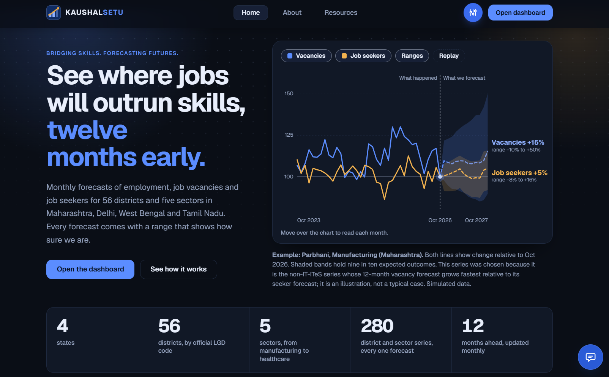
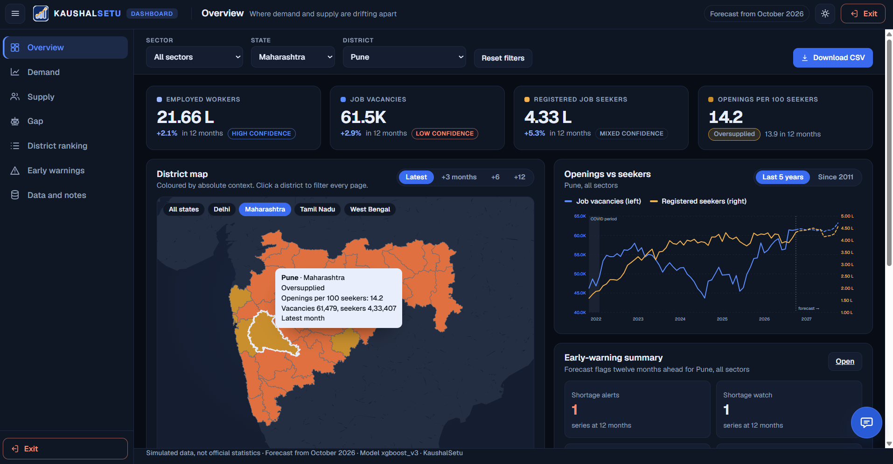
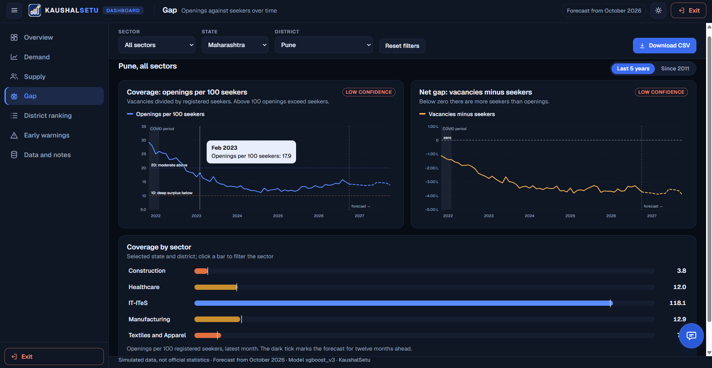
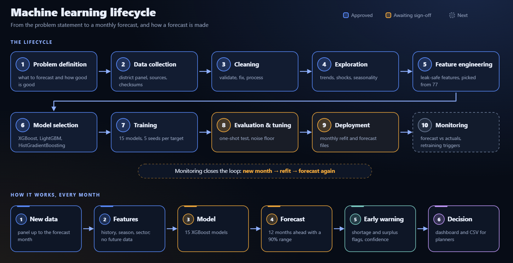

# KaushalSetu

**Bridging Skills. Forecasting Futures.**

KaushalSetu (Bridging Skills. Forecasting Futures.) is an AI-enabled labour market intelligence platform for the Ministry of Skill Development and Entrepreneurship. It forecasts, twelve months ahead, how many people will be employed, how many jobs will be open and how many job seekers will be registered, for 56 districts across four states and five sectors. Every forecast carries a 90% range and an honest confidence label, while early-warning flags show where demand for workers and supply of job seekers are drifting apart. A public website, an interactive dashboard and a built-in assistant make results easy to explore. All data is simulated.

## Problem Statement

- **Problem Statement ID**: SIH26246	
- **Problem Statement Title**: AI-Enabled Labour Market Intelligence and Skill Demand-Supply Forecasting Engine
- **Ministry / Department**: Ministry of Skill Development and Entrepreneurship (MSDE)
- **Category**: Software
- **Theme**: Miscellaneous





## 1. Why we built this and who benefits
**Why**  
Training seats are sanctioned months or years ahead, but labour demand shifts month by month and varies sharply between districts. Planners need to see *where* demand and supply are moving apart *early enough to act*, and they need to know how far to trust each number. Most tools give a point estimate; KaushalSetu gives the range, the confidence, the baseline it must beat, and the limits.

**Who Benefits**
* **MSDE and NCVET planners:** set training targets and sanction new centres where forecasts show shortage, and pause expansion where they show surplus.
* **Sector Skill Councils:** see which trades and districts are heading towards saturation or acute shortage.
* **State skill-development units:** drill from state to district, in Hindi or English.
* **Training providers and institutions:** align courses and seat allocation with expected demand.
* **Job seekers and employers (indirectly):** better-matched training means fewer certified candidates without jobs and fewer vacancies without candidates.
* **Researchers and evaluators:** a transparent, reproducible method with a measured noise floor and a tested pipeline.

## 2. Key features
**Forecasting and statistics**
* 12-month forecasts of employed workers, job vacancies and registered job seekers for 280 district-sector series.
* 90% prediction ranges, a baseline forecast beside every forecast, and a confidence label per measure (employed: high, seekers: medium, vacancies: low).
* Early-warning flags: relative status within a sector (tightest decile ... loosest decile) always shown beside the absolute context (openings exceed seekers, moderate, oversupplied, deep surplus), with alert and watch levels.

**Public website** (Home, About, Resources)
* Interactive India map of all forecast districts, with state zoom; hero forecast chart; how-it-works timeline; honest evaluation summary.
* English and Hindi, light and dark theme, three text sizes, reduced-motion support.

**Dashboard** (separate layout, top bar, collapsible sidebar, filters kept in the URL)
* Overview, Demand, Supply, Gap, District ranking, Early warnings, and Data and notes.
* Sector, State and District filters on every page; CSV download of the current view; every figure read from the forecast files and the monthly panel.

**Assistant** (button at the bottom right of every page)
* Answers from the site's own data in the browser, and optionally words answers with Google Gemini through a server-side route that keeps the API key off the page. Falls back to the site's own answers if the key, network or model quota is unavailable.

**Engineering**
* Every number on the site and dashboard is built from `forecast_long.csv`, `flags.csv` and the monthly panel, checked against SHA-256 hashes in the forecast manifest.
* Reproducible, leak-safe pipeline (no data after the origin month reaches a forecast), 143 automated tests, security headers, and a Vercel-ready layout.






## 3. Technology stack
| Layer | Technology |
|---|---|
| Language | Python 3.12+ (tested on 3.13); JavaScript (no framework) |
| Data and numerics | pandas 2.2, NumPy 2.1, SciPy 1.14, PyArrow 20 (Parquet), joblib |
| Machine learning | **XGBoost 3.4** (final models), LightGBM 4.7 and scikit-learn 1.5 (model comparison and challenger), **Optuna 4.1** (tuning) |
| Uncertainty | Static fold-based, recalibrated and adaptive conformal intervals (own implementation) |
| Front end | Hand-written HTML, CSS and JavaScript; SVG charts and map; Geist font; no build tool or framework |
| Internationalisation | English and Hindi via generated `data-hi` attributes (BeautifulSoup 4 at build time) |
| Backend | Python standard library `http.server` (local server); one Vercel Python function for `/api/chat` |
| AI assistant | Rule-based engine in the browser; Google Gemini REST API (optional, server-side key) |
| Testing | Plain-Python test files (no framework needed); Node.js (any recent version) only to syntax-check and run the assistant engine |
| Data formats | CSV, Parquet, JSON, GeoJSON |

## 4. Overview of the Dataset
The modelling dataset is a **simulated** monthly panel, calibrated to published Indian statistics where they could be verified and to stated assumptions elsewhere (see [`docs/reference/DATA_SOURCES_AND_METHODOLOGY.md`](docs/reference/DATA_SOURCES_AND_METHODOLOGY.md) for what is verified and what is not).

| Item | Detail |
|---|---|
| Files | `data/raw/lmis_district_monthly_2011_2026.csv` (53,760 rows x 41 columns) and a quarterly roll-up (17,920 x 40) |
| Series | 280 = 56 districts x 5 sectors; 192 months (January 2011 to December 2026); history to October 2026 is used |
| Geography | Maharashtra 36, Delhi 11, West Bengal 5 and Tamil Nadu 4 districts, identified by official LGD codes; 16 economic tiers |
| Sectors | Construction, Healthcare, IT-ITeS, Manufacturing, Textiles and Apparel (linked to NIC divisions and NCO-2015 codes) |
| Forecast targets | `Total_Employed_Workers`, `Active_Job_Vacancies`, `eShram_Registered_Seekers` |
| Other columns | Average monthly wage, unemployment rate, training seats sanctioned, trainees certified, demographic counts, regime flags (COVID window, e-Shram ramp) |
| Known structure | COVID shock (March 2020 to February 2022); a break at the e-Shram launch (August 2021) in registered seekers; seasonality by sector |
| Split | Train 2011-01 to 2022-02, validation 2022-03 to 2022-12, test 2023-01 to 2026-12 (70/5/25 of calendar months, same cut dates for all series) |
| Integrity | Raw files are never edited; `data/raw/DATA_MANIFEST.json` holds checksums; the test split was opened once and is spent |

Derived tables live in `data/processed/` (cleaned panels, dimension tables, `SCHEMA.json`), and the data dictionaries are in `docs/reference/`.

## 5. ML model and its evaluation metrics


**Model.** One XGBoost model per target (employed workers, job vacancies, registered seekers), each averaged over 5 seeds: 15 models. Tuned with Optuna on training and validation data only, then refitted monthly with nothing re-tuned.

**Evaluation.** Time-based split (train to 2022-02, validation to 2022-12, test 2023 to 2026). The test period was opened once. Metric: **WAPE** (lower is better).

### Test results

| Target | Model WAPE | Best simple baseline | Improvement | Noise floor* |
|---|---|---|---|---|
| Employed workers | **1.75%** | 2.46% | **29%** | 1.13% |
| Registered seekers | **5.69%** | 6.69% | **15%** | 4.73% |
| Job vacancies | **9.16%** | 9.44% | **3%** | 6.74% |

*The lowest error any model could reach on this simulated data.

### Error by forecast horizon (model vs. last value + seasonal shift)

| Months ahead | Employed | Seekers | Vacancies |
|---|---|---|---|
| 1 | **1.07** vs 1.17 | **4.03** vs 4.55 | **5.36** vs 5.69 |
| 6 | **1.78** vs 2.70 | **5.96** vs 6.63 | **8.87** vs 9.42 |
| 12 | **2.07** vs 4.80 | **6.44** vs 8.35 | **12.04** vs 12.26 |

### Results by sector (WAPE %)

| Sector | Employed | Vacancies | Seekers |
|---|---|---|---|
| Construction | 1.72 | 7.86 | 5.92 |
| Healthcare | 1.73 | 7.53 | 5.50 |
| IT-ITeS | 1.73 | 13.42 | 6.41 |
| Manufacturing | 1.79 | 8.59 | 5.42 |
| Textiles and Apparel | 1.70 | 8.76 | 5.51 |

### Held up on new data: model (best baseline), WAPE %

| Data set | Employed | Vacancies | Seekers |
|---|---|---|---|
| Original test | **1.75** (2.46) | **9.16** (9.44) | **5.69** (6.69) |
| Fresh world, seed 2027 | **1.73** (2.35) | **8.94** (9.37) | **6.00** (7.00) |
| Fresh world, seed 2028 | **1.68** (2.36) | **9.20** (9.39) | **5.91** (6.86) |

### Uncertainty and flags

| Target | 90% range method | Coverage, original test | Coverage, fresh data |
|---|---|---|---|
| Employed | Static | 93.0% | 93.0% to 93.7% |
| Vacancies | Recalibrated static | 90.0% | 88.9% to 90.4% |
| Seekers | Adaptive conformal | 91.0% | 90.9% to 91.0% |

Every forecast has a confidence label: high for employed, medium for seekers, low for vacancies. Early-warning flags are right 65% to 81% of the time; they beat repeating today's flag significantly only for oversupply at 12 months (0.676 vs 0.646), so they are labelled low confidence.

**Limits.** The data is simulated. Vacancy forecasts add only about 3% over a simple baseline and are weakest for IT-ITeS (13.4%).

## 6. Tests done and their overview
**143 automated tests in 14 files, all passing.** Run any file with `python tests/<name>.py` (no pytest needed).

| Area | Test file | Tests | What it proves |
|---|---|---|---|
| Website | `test_app.py` | 20 | Links and anchors, numbers equal the source files, map data, complete Hindi text, notices, accessibility basics, pages rebuild reproducibly |
| Dashboard | `test_dashboard.py` | 9 | Every forecast value and flag equals `forecast_long.csv` and `flags.csv` (all 10,080 and 3,360 rows), manifest hashes, frame and filters, no typed-in numbers, one logo |
| Assistant | `test_chat.py` | 7 | The answer engine (run under Node) returns the CSV values; no network use beyond one route |
| Assistant server | `test_chat_proxy.py` | 13 | Key only in a header, rules in the system instruction, limits, model fallback, error handling, security headers, no secrets in the repo |
| Data pack | `test_dashboard_pack.py` | 7 | Boundaries and metrics match the districts and source areas |
| Data | `test_processed_panel.py` | 15 | Cleaned panel, dimension tables and dictionary coverage; test period locked |
| EDA | `test_eda_outputs.py` | 7 | EDA tables and findings match the write-up |
| Features | `test_features.py` | 13 | No leakage: features at a given origin never use later data |
| Model selection | `test_models.py` | 8 | Phase 6 comparison tables and selection |
| Splits | `test_splits.py` | 6 | Split files rebuild identically from truncated data; checksums; test split locked |
| Training | `test_training.py` | 13 | Preprocessing fitted on train only, reproducibility, saved-model prediction |
| Evaluation | `test_evaluation.py` | 10 | Frozen model hashes, one-shot test access log, reported tables |
| Phase 8 addendum | `test_phase8_addendum.py` | 7 | Noise floor, flag significance, fresh draws, declared v3 configuration |
| Deployment | `test_deployment.py` | 8 | 100% coverage of 280 series x 3 targets x 12 horizons, no missing or inverted values, byte-identical re-run, no look-ahead |


## 7. Quick start and installation

**Requires** Python 3.12+ and git.

```bash
git clone https://github.com/<your-account>/<repo-name>.git
cd <repo-name>
python -m venv .venv
.venv\Scripts\activate          # macOS/Linux: source .venv/bin/activate
pip install -r requirements.txt
```

**Run the website and dashboard**
```bash
python src/app/serve.py
```
Website: `http://localhost:8080` · Dashboard: `http://localhost:8080/dashboard/index.html`

**Enable the Gemini assistant (optional)**
```bash
cp .env.example .env            # add your key after GEMINI_API_KEY=
```
Without a key the assistant still answers from the site's own data. Never commit `.env`.

**Run the tests**
```bash
python tests/test_app.py
python tests/test_dashboard.py
python tests/test_chat.py
python tests/test_chat_proxy.py
```

**Make a new monthly forecast and rebuild the site**
```bash
python src/deployment/refit.py --origin 2026-10
python src/deployment/forecast.py --origin 2026-10
python src/app/build_site_data.py
python src/app/build_dashboard.py
python src/app/build_pages.py
```


## 8. Folder structure
```
.
├── README.md
├── requirements.txt           Python dependencies (the deployed function needs none)
├── .env.example               copy to .env and add GEMINI_API_KEY (the real .env is git-ignored)
├── .gitignore
├── app/                       the website and dashboard: deploy this folder (Vercel Root Directory)
│   ├── index.html  about.html  resources.html
│   ├── vercel.json            security and cache headers, function time limit
│   ├── api/chat.py            the assistant's server route (Gemini proxy)
│   ├── assets/                styles, scripts, logo, favicon, Hindi text
│   ├── dashboard/             dashboard page, script, styles and data file
│   ├── data/                  site data and map data (built from the forecast files)
│   └── README.md              how the site is built and deployed
├── src/
│   ├── app/                   builds the site, dashboard and map; local server; i18n; logo
│   ├── deployment/            monthly refit and forecast (Phase 9)
│   ├── data_generation/       synthetic data generator (v2)
│   ├── data_collection/       raw-data audit
│   ├── preprocessing/         cleaning pipeline
│   ├── common/                guarded data access and split definitions
│   ├── eda/  features/  models/  splits/  training/  evaluation/   Phases 4-8
│   └── dashboard/             builds the dashboard data pack
├── data/
│   ├── raw/                   immutable simulated panel, district catalogue, NCO crosswalk, manifest
│   ├── processed/             cleaned panels, dimension tables, schema
│   ├── dashboard/             district boundaries and the dashboard data pack
│   └── splits/                split_manifest.json (checksums; the split files are rebuilt)
├── models/
│   ├── xgboost_v3/            declared configuration, interval policy and primary models
│   └── deployed/origin_2026-10/   the refitted models the forecast uses
├── outputs/forecasts/origin_2026-10/   forecast_long.csv, flags.csv, manifest.json
├── reports/                   EDA, feature, model, evaluation, training and deployment reports
├── tests/                     14 test files, a shared guard helper and the assistant test runner
└── docs/
    ├── RUNBOOK.md             monthly run, retraining triggers, rollback
    ├── DASHBOARD_BRIEF.md     dashboard data pack description
    ├── reference/             data dictionaries, data sources and methodology
    ├── ml-lifecycle.svg           ML lifecycle diagram source (the PNG is in screenshots/)
    ├── system-architecture.svg    architecture diagram source (the PNG is in screenshots/)
    └── screenshots/           images used in this README
```
**Kept on your machine, not in the repository** (listed in `.gitignore`): the phase write-ups `docs/phases/`; earlier versions `models/xgboost_v1/`, `models/xgboost_v2/`, `data/superseded/`, `src/data_generation/legacy/`, `Archived/`; the quarantined prototype (`src/modeling/` and every `quarantine/` folder); regenerable files (`data/splits/*.parquet`, `data/interim/`, `data/fresh_draws/`, `data/external/`); `backups/`; and the local `.env`.

## 9. Future improvements
* **Phase 10 monitoring:** score each month's forecast against the actuals that arrive, track WAPE, interval coverage and flag precision against the baseline and the noise floor, and apply the retraining triggers in the runbook; add a forecast-versus-actual page to the dashboard.
* **Real data:** replace the simulator with PLFS, e-Shram, NCS and training-centre data, and re-validate the model, the confidence labels and the flag thresholds on it.
* **Wider coverage:** forecast all districts of West Bengal (5 of 23 now) and Tamil Nadu (4 of 38), then more states and trades.
* **A forecast API:** serve forecasts and flags through a documented REST API for scheme-planning workflows (today they are batch files and CSV downloads).
* **Better vacancy and flag models:** vacancies add only about 3% over a baseline; richer demand signals (job-portal and hiring data) and better-calibrated flags are the main modelling opportunities.
* **Scenario tools:** "what if" seat allocations and a recommended training-target view for planners.
* **Automation:** a scheduled monthly job that refits, forecasts, rebuilds and publishes, with an alert if any check fails.

## 10. References
**Data and statistics sources** (the simulator is calibrated to these where verifiable; see the Resources page of the site)
1. Ministry of Statistics and Programme Implementation, *Periodic Labour Force Survey (PLFS)*, <https://mospi.gov.in/>
2. Office of the Registrar General and Census Commissioner, India, *Census of India 2011*, <https://censusindia.gov.in/>
3. Ministry of Labour and Employment, *e-Shram portal*, <https://labour.gov.in/>
4. Directorate General of Employment, *National Classification of Occupations 2015 (NCO-2015)*, <https://dge.gov.in/>
5. Local Government Directory (LGD), *district and state codes*, <https://lgdirectory.gov.in/>; Maharashtra Land Records LGD directory, <https://mahavillages.mahabhumi.gov.in/>
6. NASSCOM, *IT-BPM sector workforce figures*, <https://nasscom.in/>
7. District boundary geometry: Bharat Atlas, <https://bharatlas.com/> (simplified for display; licence recorded in `app/data/map_data.js`)

**Methods**  

8. Chen, T. and Guestrin, C. (2016). *XGBoost: A Scalable Tree Boosting System.* Proceedings of the 22nd ACM SIGKDD Conference. 

9. Akiba, T., Sano, S., Yanase, T., Ohta, T. and Koyama, M. (2019). *Optuna: A Next-generation Hyperparameter Optimization Framework.* KDD 2019.  

10. Gibbs, I. and Candes, E. (2021). *Adaptive Conformal Inference Under Distribution Shift.* NeurIPS 2021.  

11. Angelopoulos, A. N. and Bates, S. (2021). *A Gentle Introduction to Conformal Prediction and Distribution-Free Uncertainty Quantification.* arXiv:2107.07511. 

12. Ke, G. et al. (2017). *LightGBM: A Highly Efficient Gradient Boosting Decision Tree.* NeurIPS 2017 (model-selection comparison).
